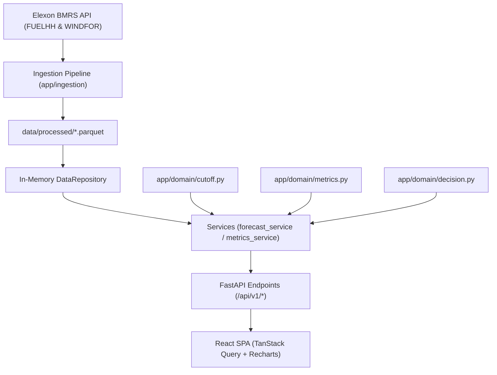

# System Architecture & Technical Flow

## Overview

The **UK Wind Forecast Decision Dashboard** is built as an end-to-end, single-container production web application. It combines a high-performance **FastAPI** backend with a modern **React 18 + TypeScript** frontend styled using Tailwind CSS and Radix UI primitives.

## Layered Design & Separation of Concerns

1. **Ingestion Pipeline (`app/ingestion/`)**:
   - `elexon_client.py`: Resilient HTTP client with automatic chunking (48h windows) and exponential backoff retry.
   - `fetch_data.py`: CLI ingestion script normalizing timestamps to UTC, dropping invalid or duplicated records.
   - `validate.py`: Quality validation generating data profiles into `docs/DATA_NOTES.md`.

2. **In-Memory Repository (`app/data/repository.py`)**:
   - Parquet files (`actuals.parquet` and `forecasts.parquet`) are loaded once into RAM at startup.
   - Eliminates live external API dependencies at runtime, ensuring deterministic responses well under 50 ms.

3. **Pure Domain Logic (`app/domain/`)**:
   - `cutoff.py`: Timezone-aware cutoff conversion (`zoneinfo("Europe/London")`), half-hour slot grid alignment, and candidate filtering selecting the maximum `publish_time <= cutoff_utc`.
   - `metrics.py`: Pure mathematical computation of MAE, RMSE, Bias, wMAPE, empirical signed and absolute error quantiles, and breakdowns by hour, lead horizon, and day.
   - `decision.py`: Derivation of the P90 shortfall buffer and empirical uncertainty bands with strict prevention of look-ahead leakage.

4. **Orchestration Services (`app/services/`)**:
   - `forecast_service.py`: Orchestrates cutoff selection for delivery days and calculates historical error quantiles derived exclusively from prior decision days.
   - `metrics_service.py`: Aggregates historical metrics across the full month.

5. **API Presentation (`app/api/v1/`)**:
   - Thin FastAPI controllers validating query parameters and returning typed Pydantic models.

6. **Frontend Dashboard (`frontend/src/`)**:
   - React 18, TypeScript, and TanStack Query with optimistic caching.
   - Visualized with custom Recharts charts for the main forecast vs actual envelope, intraday hour patterns, horizon curves, and quantile distributions.
